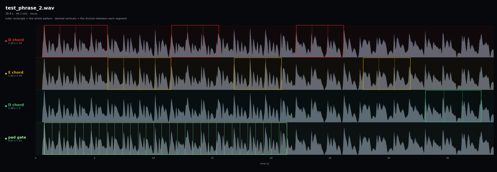

***Agents asked to use the analyze-palettes skill should ignore this document and everything in this directory entirely, using the algorithms as they exist in the skill itself.*** This directory is only for calibrating those algorithms beforehand. Agents tasked with doing this will be explicitly asked to work within this directory. 

## Definitions

- **Segment**: one iteration of a pattern — the audio between two adjacent
dashed lines. Every segment in a pattern is the same length, but different patterns can have different segment lengths, not necessarily multiples of each other. The dashes mark that uniform grid; they are not
measured beat positions.
- **Pattern**: a region that repeats at one fixed loop length **for at least three
segments**, running from its measured start to the end of its last complete
segment. The rectangle bounds it. Patterns are derived by tracking some distinct fundamental element that repeats in the same place in the segment, segment by segment. This could be an identifiably unique onset or a specific pitch that occurs in the same position in the segment. Patterns are independent of each other;
two patterns can share a segment length and still count separately because they are tracking different contents in their repetitions, i.e. an onset in one position of the segment (and/or timbre or pitch) versus another.
- **Phrase**: the full extent of the audio from the beginning to the end of all
of its overlapping patterns. 
- **Palette**: a full jam session recorded beginning to end with no editing. Palettes are analyzed for their patterns and have their phrases extracted before building the final song.
- **Stem**: a single instrument track of the final song. Stems are not relevant during this analysis step and only come into play later when the song is constructed.

## Purpose

Outlined in this document are calibration tests which the algorithm implemented in the analyze-palettes skill must pass. The goal is for that algorithm, whatever form it takes, to identify the exact segments, patterns and phrases detailed below from the given test_phrase.wav files also residing in this directory. In doing so the analysis should treat those test_phrase.wav files as if they were real palettes. 

Each test phrase below will have a key with the "correct" stats that should be derived from the audio. Floating point values such as segment lengths etc. do not need to match absolutely perfectly but they must be close. A discussion will also follow as to why the values in the key are the desired ones. It is essential to understand the intent and the purpose of these algorithms in order to build methods that will generalize to any palette seen in the future, and not just resort to any short-sighted solution that happens to generate the correct answers. 

## Reading the diagram

- The gray trace is the same waveform drawn once per pattern, so every pattern
  has its own row against the shared time axis. The waveform is a single mono recording; every row comes from the same audio and nothing here is a stack of separate stems.
- The **outer rectangle** is the whole pattern: from its measured start to
  the end of its last complete segment.
- The **dashed verticals** divide the row into segments, one per loop
  iteration, at the pattern's loop length.
- The row label gives a subjective description of the element being tracked (these are by no means standard and could be anything that helps orient the listener to the pattern evident) and `loop × segments`.
  
# test_phrase_1.wav

## Results 

| Tracked element | Segment length (s) | Segments | Region (s) |
|---|---:|---:|---|
| bass | 1.07 | 73 | 0.00–78.11 |
| cymbal | 2.15 | 35 | 2.15–77.40 |
| kick | 2.15 | 35 | 2.15–77.40 | 
| kick | 2.15 | 6, 5 | 2.15–15.05, 38.65–49.40 | 

## Discussion 

1. **Unique tracked elements.** The most fundamental driver of any pattern is the unique element it is tracking. Again, these descriptions here (e.g., bass, etc.) are purely subjective. The point is that each are uniquely characterizable by things like their onset, their timbre, their pitch, etc. For example, the bass and kick are both low frequency spectrally, but the kick has a much more staccato envelope and so both are distinct. Once a fundamental element has been characterized, it becomes a tracked pattern if it repeats at regular intervals throughout some portion of the recording.
2. **Even more defining than the tracked element itself is its position within the segment.** For example, we see there are two tracked elements labeled "kick". These are actually the exact same drum sample but they occur in different places within the segment length and therefore constitute distinct patterns. The first occurs on the downbeat and the second when it occurs is always on its own syncopated beat.
3. **A single tracked element can have non-contiguous patterns.** We can see that the second, syncopated kick occurs in two separate patterns throughout the phrase. The segments of the patterns must be contiguous but any break in them can divide it into multiple patterns without issue. Of note here is that there could actually be considered a third pattern in this row at approximately 67 seconds to 69 seconds. However, that pattern has been excluded because it is only one segment length long and all patterns are required to be at least three segments long.
4. **A distinct element deserves a distinct pattern, even if that pattern is shared exactly by another element.** Here you can see that the cymbal and the downbeat kick have the exact same pattern and segments but are still listed as separate patterns. In a more experimental or chaotic recording two elements might blend together, losing distinction and therefore could be seen as a single pattern, which would not be wrong. This recording however is crisp and clear and the two can be heard as distinctly separate and so two separate patterns are produced. 
5. **Starts are measured, not shared.** The bass begins at 0.00 s and the other
   two at 2.15 s, so the first 2.15 s hold the bass alone. Pattern starts come
   from the audio; they are not snapped to a common grid or to a pass loop
   point.
6. **Each pattern has its own uniform grid.** The bass divides every 1.07 s from
   0.00 s, the cymbal and kick every 2.15 s from 2.15 s. No grid is imposed across patterns; in reality, the exact start position of a pattern within its segment for a given element is arbitrary, but since all patterns come from the same audio, it can be assumed that their borders should align where sensible. For example, the bass pattern has two preceding segments, but the cymbal when it starts begins exactly aligned with that third bass segment.
7. **The cycle count is an integer and the remainder is dropped.** 73 × 1.07 =
   78.11 s and 35 × 2.15 = 75.25 s. The recording is 78.9 s, so 0.79 s and
   1.50 s of tail sit outside the regions: a pattern ends at its last complete
   segment

# test_phrase_2.wav

## Results

| Tracked element | Segment length (s) | Segments | Region (s) |
|---|---:|---:|---|
| D chord | 1.34 | 4, 3, 3 | 0.73–6.09, 11.54–15.56, 22.14–26.16 |
| E chord | 1.34 | 4, 3, 3 | 6.13–11.49, 16.86–20.88, 27.82–31.84 |
| D chord | 1.58 | 3 | 33.11–37.85 |
| pad gate | 0.67 | 31 | 0.73–21.35 |

## Discussion

1. **A tracked element can be a pitch rather than an instrument.** This palette is
one gated pad, struck the same way throughout, so timbre cannot separate its
patterns. The pitch does: the D chord is built on 293 Hz with partials at 583,
883 and 1174 Hz plus a 183 Hz F# line, and the E chord on 330 Hz with partials
at 657, 990 and 1313 Hz. Same gesture, different content in the segment,
therefore two elements and two patterns. This is the rule from test_phrase_1
that a distinct element deserves a distinct pattern even when another shares its
region exactly.
2. **The accent fixes the loop and the gate does not.** The pad is re-struck every
0.67 s, but the strikes alternate by roughly 5 dB: one is the accent and the
next is its release. Tracking the accented strike puts the loop at 1.34 s, so a
segment holds an accent and the release that follows it. The fourth row tracks
the bare strike instead and folds at 0.67 s. That is the nested-period case: the
surface pulse repeats at half the loop, and the loop is what carries the accent.
Taking 0.67 s everywhere would describe the texture but lose the pattern the
listener hears.
3. **A single element can have non-contiguous patterns.** The chords alternate
every eight strikes, four loops or about 5.3 s: D, E, D, E, D, E, D. Neither
chord's pattern is contiguous, because each is interrupted by the other chord,
and every interruption starts a new span exactly as the breaks in the syncopated
kick row do.
4. **A pattern has one loop length, so a slower section is a new pattern.** The
last D chord is gated more slowly: its accent loop measures 1.58 s where every
earlier chord measures 1.34 s, and its strikes land at 33.11, 34.69, 36.27 and
37.85. It is listed as a separate pattern rather than stretched across the
earlier grid.
5. **Starts are measured, not shared.** The seven spans begin at 0.73, 6.13, 11.54,
16.86, 22.14, 27.82 and 33.11 s, each the first accented strike of its chord.
Nothing is snapped to a common grid or to the 0.67 s gate, and the sliver left
at each chord change, 0.04 s at the first two changes and 1.3–1.7 s at the rest,
sits outside every region.
6. **Each pattern has its own uniform grid.** The gate divides at 0.665 s, the
chord accents at 1.34 s, and the closing D chord at 1.58 s. No grid is imposed
across patterns. The performance breathes, its strikes landing between 0.62 and
0.72 s apart, so each grid is the measured mean of its span and the dashes are
that uniform idealisation, not the performed positions.
7. **The cycle count is an integer and the remainder is dropped.** 4 × 1.34 = 5.36
s (0.73–6.09), 31 × 0.665 = 20.615 s (0.73–21.35) and 3 × 1.58 = 4.74 s
(33.11–37.85). The recording is 38.9 s, so the 1.07 s tail after 37.85 and every
partial loop at a chord change sit outside the regions: a pattern ends at its
last complete segment.
