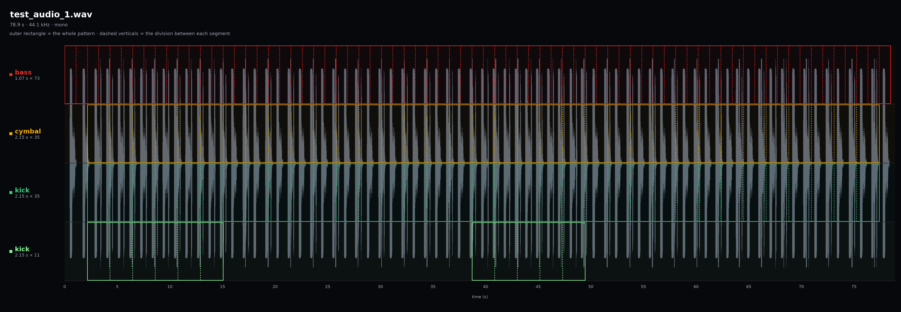
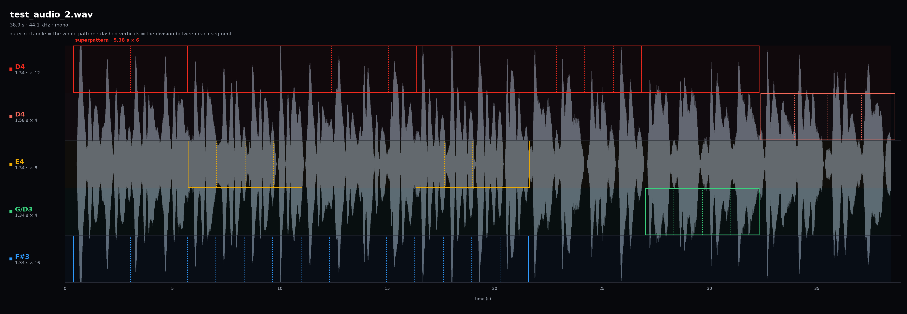

***Agents asked to use the analyze-palettes skill should ignore this document and everything in this directory entirely, using the algorithms as they exist in the skill itself.*** This directory is only for calibrating those algorithms beforehand. Agents tasked with doing this will be explicitly asked to work within this directory. 

## Definitions

- **Segment**: one iteration of a pattern — the audio between two adjacent
dashed lines. Every segment in a pattern is the same length, but different patterns can have different segment lengths, not necessarily multiples of each other. The dashes mark that uniform grid; they are not
measured beat positions.
- **Pattern**: a region that repeats at one fixed loop length **for at least three
segments**, running from its measured start to the end of its last complete
segment. The rectangle bounds it. Patterns are derived by tracking some distinct fundamental element that repeats in the same place in the segment, segment by segment. This could be an identifiably unique onset or a specific pitch that occurs in the same position in the segment. Patterns are independent of each other;
two patterns can share a segment length and still count separately because they are tracking different contents in their repetitions, i.e. an onset in one position of the segment (and/or timbre or pitch) versus another.
- **Superpattern**: a pattern comprised of, rather than tracked elements repeating, other smaller patterns repeating. 
- **Phrase**: the full extent of the audio from the beginning to the end of all
of its patterns/superpatterns that overlap by at least one full segment. 
- **Palette**: a full jam session recorded beginning to end with no editing. Palettes are analyzed for their patterns and have their phrases extracted before building the final song.
- **Stem**: a single instrument track of the final song. Stems are not relevant during this analysis step and only come into play later when the song is constructed.

## Purpose

Outlined in this document are calibration tests which the algorithm implemented in the analyze-palettes skill must pass. The goal is for that algorithm, whatever form it takes, to identify the exact segments, patterns and phrases detailed below from the given test_audio.wav files also residing in this directory. In doing so the analysis should treat those test_audio.wav files as if they were real palettes. 

Each test phrase below will have a key with the "correct" stats that should be derived from the audio. Floating point values such as segment lengths etc. do not need to match absolutely perfectly but they must be close. A discussion will also follow as to why the values in the key are the desired ones. It is essential to understand the intent and the purpose of these algorithms in order to build methods that will generalize to any palette seen in the future, and not just resort to any short-sighted solution that happens to generate the correct answers. 

## Reading the diagram

- The gray trace is the same waveform drawn once per pattern, so every pattern
  has its own row against the shared time axis. The waveform is a single mono recording; every row comes from the same audio and nothing here is a stack of separate stems.
- The outer rectangle is the whole pattern: from its measured start to
  the end of its last complete segment. Its start sits part of a loop before the
  first tracked onset, so no attack is split by a segment edge.
- The dashed verticals divide the row into segments, one per loop
  iteration, at the pattern's loop length.
- Any superpatterns present are drawn on the diagram in the same rectangles and dashed verticals as other patterns but with thicker lines and lighter opacity.
- The row label gives a subjective description of the element being tracked (these are by no means standard and could be anything that helps orient the listener to the pattern evident) and `loop × segments`.
  
# test_audio_1.wav

## Results 

| Tracked element | Segment length (s) | Segments | Region (s) |
|---|---:|---:|---|
| bass | 1.07 | 73 | 0.00–78.11 |
| cymbal | 2.15 | 35 | 2.15–77.40 |
| kick | 2.15 | 35 | 2.15–77.40 | 
| kick | 2.15 | 6, 5 | 2.15–15.05, 38.65–49.40 | 

## Discussion 

1. **Unique tracked elements.** The most fundamental driver of any pattern is the unique element it is tracking. Again, these descriptions here (e.g., bass, etc.) are purely subjective. The point is that each are uniquely characterizable by things like their onset, their timbre, their pitch, etc. For example, the bass and kick are both low frequency spectrally, but the kick has a much more staccato envelope and so both are distinct. Once a fundamental element has been characterized, it becomes a tracked pattern if it repeats at regular intervals throughout some portion of the recording.
2. **Even more defining is the tracked element's position within the segment.** For example, we see there are two tracked elements labeled "kick". These are actually the exact same drum sample but they occur in different places within the segment length and therefore constitute distinct patterns. The first occurs on the downbeat and the second when it occurs is always on its own syncopated beat.
3. **A single tracked element can have non-contiguous patterns.** We can see that the second, syncopated kick occurs in two separate patterns throughout the phrase. The segments of the patterns must be contiguous but any break in them can divide it into multiple patterns without issue. Of note here is that there could actually be considered a third pattern in this row at approximately 67 seconds to 69 seconds. However, that pattern has been excluded because it is only one segment length long and all patterns are required to be at least three segments long.
4. **A distinct element deserves a distinct pattern, even if that pattern is shared exactly by another element.** Here you can see that the cymbal and the downbeat kick have the exact same pattern and segments but are still listed as separate patterns. In a more experimental or chaotic recording two elements might blend together, losing distinction and therefore could be seen as a single pattern, which would not be wrong. This recording however is crisp and clear and the two can be heard as distinctly separate, so two separate patterns are produced. 
5. **Starts are measured, not shared.** The bass begins at 0.00 s and the other
   two at 2.15 s, so the first 2.15 s hold the bass alone. Pattern starts come
   from the audio; they are not snapped to a common grid or to a pass loop
   point.
6. **Each pattern has its own uniform grid.** The bass divides every 1.07 s, the cymbal and kick every 2.15 s. No grid is imposed across patterns; in reality, the exact start position of a pattern within its segment for a given element is arbitrary. The alignment seen here is merely incidental. 
7. **The cycle count is an integer and the remainder is dropped.** 73 × 1.07 =
   78.11 s and 35 × 2.15 = 75.25 s. The recording is 78.9 s, so 0.79 s and
   1.50 s of tail sit outside the regions: a pattern ends at its last complete
   segment

# test_audio_2.wav

## Results

| Tracked element | Segment length (s) | Segments | Region (s) |
|---|---:|---:|---|
| D4 | 1.34 | 4, 4, 4 | 0.40–5.76, 11.21–16.57, 21.81–27.17 |
| D4 superpattern | 10.77 | 3 | 0.40–32.71 |
| D4 | 1.58 | 4 | 32.78–39.10 |
| E4 | 1.34 | 4, 4 | 5.80–11.16, 16.53–21.89 |
| G/D3 | 1.34 | 4 | 27.35–32.71 |
| F#3 | 1.34 | 16 | 0.40–21.84 |

## Discussion

1. **A tracked element can be a pitch rather than an instrument.** This palette is
built from sustained synth voices that share one timbre throughout, so timbre
cannot separate its patterns and the row labels simply name the pitch each one
tracks. Same gesture, different identity, therefore distinct elements and distinct patterns. Again, the labels are arbitrary and here simply denote the prominent pitch, what would be distinct to a listener, without quibbling over the exact harmonic content.
2. **The off-beat strike is a second voice, not a softer stab.** Each of the initial D4 and E4
stabs are followed about two thirds of a second later by another F#3 strike: two voices in anti-phase, not one voice at
two levels. The F#3 voice is the fifth tracked element, because of its distinct identity.
3. **That voice is one element with one contiguous pattern, ending partway.**
It runs under both D4 and E4 and never stops for a change of pitch, so unlike
those rows its pattern is a single run of 16 segments. After the
sixteenth strike the next eight loops of the same grid carry no strike.
One could argue the pitch itself returns at 32.68 s as a sustained tone over the closing section,
but as a held note rather than a repeating strike, so no further F#3 pattern is
claimed.
4. **A single element can have non-contiguous patterns.** The D4 and E4 patterns
take turns every four loops: D4, E4, D4, E4, D4, then the low G/D3
span, then the slower D4. None of the first five is contiguous, because each is
interrupted by the next, and every interruption starts a new span exactly as the
breaks in the syncopated kick row do. The F#3 pattern is the opposite case: one
element, one unbroken run, laid over the span the others divide between
them.
5. **A pattern has one loop length, so a slower section is a new pattern.** The
last D4 span is gated more slowly; its stabs land at 33.11, 34.60, 36.22 and
37.83 s, gaps of 1.49, 1.62 and 1.60 s that average 1.571 s against 1.350 s for
the 24 gaps before them, 16% longer. Against that 1.35 s grid the four stabs
fall 0.00, 0.14, 0.41 and 0.66 s late, so the lag accumulates rather than
appearing once. This denies the theory of a single displaced strike, which would leave the gaps either side of it
summing to the old loop length and put the fourth stab back on the grid. At
0.66 s late, it does not; the third strike is simply where the stretch becomes
audible. The row therefore draws that as one uniform 1.58 s loop, within 0.09 s of each
measured gap.
6. **Starts are arbitrary.** Nothing is snapped to a common grid for its own sake; the rows happen to agree simply because the audio puts them on the same pulse. The important part is that the tracked elements are encompassed by their segments and not cut off by a division. 
7. **The cycle count is the number of strikes heard and the remainder is
dropped.** However, as seen here, the last segment cannot be cut short by a separate pattern starting on another row, so it is appropriate for the pattern to count that last segment at its full length, as long as the tracked element exists within it as it does the others. 
8. **There is one superpattern in this example.** Superpatterns can be identified by looking at just a single set of repeating patterns, i.e. one row only on the diagram at a time. Each segment should include the subpattern as well as the non-pattern space in the repetition, just like a normal pattern contains a tracked element and the non-tracked element space in the segment. Here, this results in three equal segments. Superpatterns can be identified without having to reanalyze or measure anything since they are only multiples of smaller patterns which have already been mapped and drawn — notice how the superpattern could be identified simply by looking at the stats table above. Of note is that the third line (E4) has two patterns that repeat but this does not result in a superpattern because the basic pattern requirement of having at least three segments still holds. 
